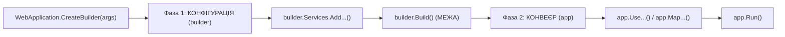

# 01. Мінімальний хост ASP.NET Core (01.Hosting.Minimal)

## Призначення та огляд

Цей проєкт демонструє, з чого взагалі складається веб-застосунок на сучасній платформі .NET 10:
1. **Generic Host** — каркас керування життєвим циклом, DI-контейнером, конфігурацією та логуванням.
2. **HTTP-сервер Kestrel** — високопродуктивний крос-платформний сервер, що приймає мережеві з'єднання і транслює їх в об'єкт `HttpContext`.
3. **Конвеєр обробки (Pipeline)** — ланцюжок middleware.
4. **Graceful Shutdown** — керована зупинка процесу з коректним завершенням активних запитів.

---

## Архітектура: Дві фази життєвого циклу

Весь `Program.cs` чітко розділений на дві фундаментальні фази:



### 1. `builder` (Фаза наповнення)
До виклику `builder.Build()` ми лише конфігуруємо сервіси:
- `builder.Services` — колекція опису типів (`IServiceCollection`).
- Спроба додати новий сервіс після `Build()` викличе виняток `InvalidOperationException`. Це зроблено навмисно: контейнер стає незмінним (immutable) для детермінованості роботи застосунку.

### 2. `app` (Фаза виконання)
Після `builder.Build()` ми маємо екземпляр `WebApplication`, на якому налаштовуємо middleware та маршрути.

---

## Що `CreateBuilder` дає з коробки

Без жодного рядка додаткового коду метод `WebApplication.CreateBuilder(args)` налаштовує:
- **Конфігурацію:** читання `appsettings.json`, `appsettings.{Environment}.json`, User Secrets (у Dev), змінних середовища та аргументів командного рядка.
- **Логування:** вивід у консоль (Console), Debugger та EventSource.
- **HTTP-сервер:** Kestrel як сервер за замовчуванням.
- **DI-контейнер:** швидкий та оптимізований контейнер з валідацією областей (Scope Validation) у режимі Development.

---

## Хуки життєвого циклу та Graceful Shutdown

Хост надає сервіс `IHostApplicationLifetime` із трьома подіями:
```csharp
app.Lifetime.ApplicationStarted.Register(() => app.Logger.LogInformation("Застосунок запущено"));
app.Lifetime.ApplicationStopping.Register(() => app.Logger.LogInformation("Зупинка: завершуємо поточні запити…"));
app.Lifetime.ApplicationStopped.Register(() => app.Logger.LogInformation("Застосунок зупинено"));
```

Коли процес отримує сигнал зупинки (наприклад `SIGTERM` у Kubernetes або `Ctrl+C` у консолі):
1. Спрацьовує `ApplicationStopping`.
2. Сервер припиняє приймати нові з'єднання.
3. Сервер очікує завершення обробки поточних запитів (до таймауту `ShutdownTimeout`, типово 30 секунд).
4. Зупиняються фонові сервіси (`IHostedService`).
5. Спрацьовує `ApplicationStopped`, і процес коректно завершується.

---

## Як запустити і перевірити

### Запуск проєкту
```bash
dotnet run --project src/01.Hosting.Minimal
```
Застосунок запуститься на порту `5001`.

### Перевірка ендпоінтів

#### 1. Перевірка інформації про середовище
```http
GET http://localhost:5001/env
```
Відповідь:
```json
{
  "applicationName": "01.Hosting.Minimal",
  "environmentName": "Development"
}
```

#### 2. Перевірка DI (резолв `ICatalog`)
```http
GET http://localhost:5001/products
```
Повертає список товарів із `InMemoryCatalog`, який було зареєстровано через `builder.Services.AddCatalog()`.

#### 3. Програмне ініціювання зупинки
```http
GET http://localhost:5001/shutdown
```
У терміналі можна спостерігати лог graceful shutdown:
```
info: 01.Hosting.Minimal[0]
      Зупинка: завершуємо поточні запити…
info: 01.Hosting.Minimal[0]
      Застосунок зупинено
```

### Швидка перевірка через cURL (термінал)
```bash
curl -i http://localhost:5001/env
curl -i http://localhost:5001/products
curl -i http://localhost:5001/shutdown
```

---

## Питання для самоперевірки та співбесід

1. **Що станеться, якщо спробувати викликати `builder.Services.AddSingleton(...)` ПІСЛЯ `var app = builder.Build()`?**
   *Відповідь:* Виникне виняток `InvalidOperationException`, оскільки після `Build()` колекція сервісів стає незмінною (read-only/frozen).
2. **Що таке Graceful Shutdown і як його налаштувати у Kubernetes?**
   *Відповідь:* Це процес, коли на сигнал `SIGTERM` сервер припиняє приймати нові TCP-з'єднання, але дає до 30 секунд (налаштовується через `HostOptions.ShutdownTimeout`) на завершення активних HTTP-запитів.
3. **Чим відрізняється Generic Host (`Host`) від `WebApplication`?**
   *Відповідь:* `Host` — це загальний контейнер для будь-яких .NET-процесів (консольних воркерів, черг). `WebApplication` — це спеціалізована надбудова над `Host` для HTTP-застосунків, що об'єднує Kestrel, конвеєр та маршрутизацію.

---

## Підсумки
- `CreateBuilder` позбавляє необхідності рутинного конфігурування інфраструктури.
- Чітке розмежування `builder` (реєстрація DI) та `app` (конвеєр middleware) є основою архітектури ASP.NET Core.
- Graceful shutdown запобігає втраті даних та раптовому обриву клієнтських запитів під час редеплою застосунку.

---
**[📋 Навігатор по всіх гайдах](README.md)** | **[Наступний: 02. Сервери та середовища →](02.Hosting.ServersAndEnvironment.md)**
