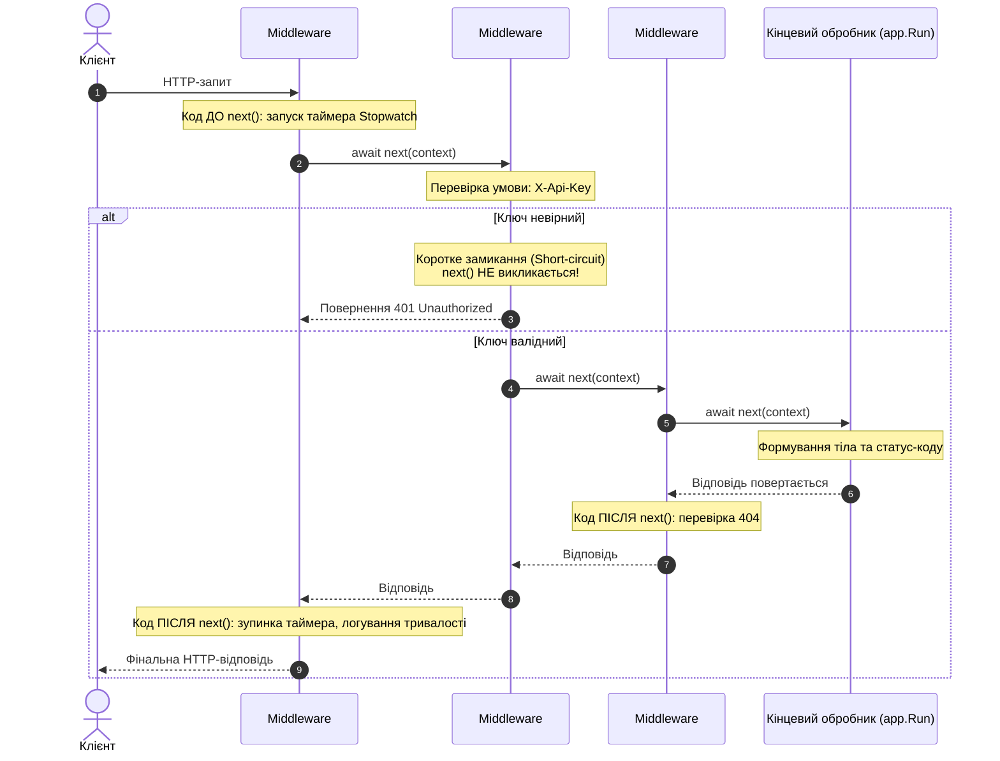

# 03. Конвеєр обробки запиту «з нуля» (03.Pipeline.FromScratch)

## Призначення та огляд

Цей проєкт демонструє фундаментальну концепцію ASP.NET Core: **HTTP-конвеєр (Request Processing Pipeline)**.
Весь веб-фреймворк — це послідовність функцій-делегатів (`Middleware`), через які проходить HTTP-запит від клієнта до обробника і повертається назад у вигляді HTTP-відповіді.

Тут навмисно **не використовуються контролери або маршрутизація**, щоб побачити роботу з «голим» `HttpContext` та механіку виконання вкладених делегатів.

---

## Архітектура: Модель «Цибулина» (Onion Architecture)

Кожен middleware приймає `HttpContext` та делегат `RequestDelegate next` — посилання на наступну ланку конвеєра.



---

## Три можливі моделі поведінки Middleware

### 1. Наскрізна обробка з діями на вході та виході
```csharp
// Middleware #1: Вимірювання часу запиту
app.Use(async (context, next) =>
{
    var sw = Stopwatch.StartNew();
    context.Response.Headers["X-Request-Id"] = Guid.NewGuid().ToString();

    await next(context); // ← провалюємось глибше в конвеєр

    // Код на шляху назад:
    app.Logger.LogInformation("{Method} {Path} → {Status} за {Ms} мс",
        context.Request.Method, context.Request.Path,
        context.Response.StatusCode, sw.ElapsedMilliseconds);
});
```

### 2. Коротке замикання (Short-Circuit)
Якщо умова не виконана, middleware формує відповідь і **НЕ викликає `next(context)`**:
```csharp
// Middleware #2: Перевірка секретного заголовка
app.Use(async (context, next) =>
{
    if (context.Request.Path == "/secret" && context.Request.Headers["X-Api-Key"] != "let-me-in")
    {
        context.Response.StatusCode = StatusCodes.Status401Unauthorized;
        await context.Response.WriteAsync("Потрібен заголовок X-Api-Key: let-me-in");
        return; // ← конвеєр обірвано, решта middleware не виконуються
    }

    await next(context);
});
```

### 3. Модифікація відповіді на виході
```csharp
// Middleware #3: Дописування тексту для 404
app.Use(async (context, next) =>
{
    await next(context);

    if (!context.Response.HasStarted && context.Response.StatusCode == StatusCodes.Status404NotFound)
    {
        await context.Response.WriteAsync(" (дописано в middleware #3)");
    }
});
```
> [!IMPORTANT]
> Перевірка `!context.Response.HasStarted` є критично важливою: після того, як заголовки HTTP почали відправлятися клієнту, змінити статус-код або дописати нові заголовки вже неможливо.

---

## Як запустити і перевірити

### Запуск проєкту
```bash
dotnet run --project src/03.Pipeline.FromScratch
```
Порт: `5003`.

### Тестові сценарії

1. **Головна сторінка (проходить увесь конвеєр):**
   ```http
   GET http://localhost:5003/
   ```
   У відповіді з'являється заголовок `X-Request-Id`, а в консолі — запис часу виконання в мілісекундах.

2. **Захищений шлях без ключа (коротке замикання):**
   ```http
   GET http://localhost:5003/secret
   ```
   Повертає `401 Unauthorized` і текст `Потрібен заголовок X-Api-Key: let-me-in`.

3. **Захищений шлях із правильним ключем:**
   ```http
   GET http://localhost:5003/secret
   X-Api-Key: let-me-in
   ```
   Повертає `200 OK` і текст `Секрет розкрито: конвеєр — це просто список функцій.`.

4. **Невідомий маршрут (перехоплення на виході):**
   ```http
   GET http://localhost:5003/unknown
   ```
   Повертає `404 Not Found` і текст ` (дописано в middleware #3)`.

### Швидка перевірка через cURL (термінал)
```bash
# 1. Головна
curl -i http://localhost:5003/

# 2. Відхилення 401
curl -i http://localhost:5003/secret

# 3. Успіх із заголовком 200
curl -i -H "X-Api-Key: let-me-in" http://localhost:5003/secret

# 4. Перехоплення 404
curl -i http://localhost:5003/random-page
```

---

## Питання для самоперевірки та співбесід

1. **У якому порядку виконується код до `await next(context)` і після нього?**
   *Відповідь:* Код ДО `await next()` виконується в порядку реєстрації middleware ($1 \to 2 \to 3$). Код ПІСЛЯ `await next()` виконується у зворотному порядку розкручування стека ($3 \to 2 \to 1$).
2. **Що таке коротке замикання (short-circuiting)?**
   *Відповідь:* Це ситуація, коли middleware формує відповідь і свідомо НЕ викликає `await next(context)`. Усі наступні middleware та кінцеві ендпоінти не виконуються.
3. **Чому не можна додавати заголовки до `Response.Headers` після того, як `Response.HasStarted == true`?**
   *Відповідь:* Тому що HTTP-протокол спочатку надсилає блок заголовків, а потім тіло. Як тільки перший байт тіла відправлено в мережевий сокет, заголовки вже доставлені клієнту і спроба їх змінити викличе виняток.

---

## Підсумки
- Порядок викликів `app.Use()` — це прямий порядок проходження запиту туди, і зворотний порядок проходження відповіді назад.
- Коротке замикання — ключовий патерн для аутентифікації, CORS, статичних файлів і кешування.
- Вся подальша функціональність ASP.NET Core (Routing, MVC, Auth, OpenAPI) будується виключно поверх цієї самої моделі.

---
**[← Попередній: 02. Сервери та середовища](02.Hosting.ServersAndEnvironment.md)** | **[📋 Навігатор](README.md)** | **[Наступний: 04. Власні Middleware →](04.Pipeline.CustomMiddleware.md)**
