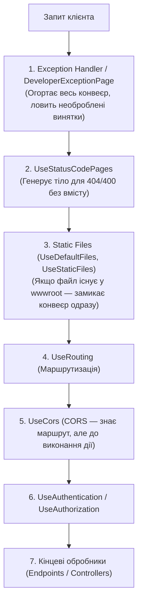

# 05. Наскрізна функціональність (05.Pipeline.CrossCutting)

## Призначення та огляд

У кожному промисловому застосунку є загальносистемні задачі (Cross-Cutting Concerns), які мають виконуватися для всіх або більшості запитів:
1. **Глобальна обробка помилок** та повернення єдиного формату **Problem Details (RFC 9457)**;
2. **Обробка статус-кодів без тіла** (`UseStatusCodePages`);
3. **Роздача статичних файлів** (`UseDefaultFiles`, `UseStaticFiles`);
4. **Міждоменні запити (CORS)**.

Усі ці механізми реалізовані як вбудовані middleware. Головний урок цього розділу: **порядок реєстрації middleware є критичним для коректної роботи системи**.

---

## Канонічний порядок у конвеєрі



### Чому порядок саме такий?
- **Exception Handling стоїть найпершим**: він має огортати абсолютно всі наступні кроки в `try/catch`. Якщо поставити його після контролерів або статичних файлів, винятки з них призведуть до аварійного скидання TCP-з'єднання замість акуратної відповіді `500 Internal Server Error`.
- **Static Files стоять до маршрутизації**: якщо запитується `GET /index.html`, сервер одразу віддає байти з диска і не витрачає ресурси на пошук відповідного маршруту серед сотень контролерів.
- **CORS стоїть після Routing, але до Endpoints**: CORS-політика може залежати від конкретного ендпоінта, але має виконатися до запуску бізнес-логіки (зокрема для обробки `OPTIONS preflight`-запитів).

---

## Розбір коду

### 1. Problem Details у .NET
```csharp
// 1. Реєстрація сервісу
builder.Services.AddProblemDetails();

// 2. Підключення у конвеєрі
if (app.Environment.IsDevelopment())
    app.UseDeveloperExceptionPage();
else
    app.UseExceptionHandler(); // Пустий виклик транслює всі unhandled exceptions у формат ProblemDetails
```

### 2. Налаштування CORS
```csharp
builder.Services.AddCors(options =>
    options.AddPolicy("demo", policy => policy
        .WithOrigins("https://example.com")
        .AllowAnyHeader()
        .AllowAnyMethod()));

// У конвеєрі:
app.UseCors("demo");
```

### 3. UseStatusCodePages
Коли ендпоінт повертає `Results.NotFound()`, за замовчуванням клієнт отримує пусте тіло. `app.UseStatusCodePages()` автоматично генерує стандартне повідомлення або Problem Details для клієнта.

---

## Як запустити і перевірити

### Запуск проєкту
```bash
dotnet run --project src/05.Pipeline.CrossCutting
```
Порт: `5005`.

### Тестові сценарії

1. **Статичний файл (віддається з wwwroot/index.html):**
   ```http
   GET http://localhost:5005/
   ```
   cURL:
   ```bash
   curl -s http://localhost:5005/
   ```
   Повертає HTML-сторінку: `<h1>Привіт із wwwroot/index.html</h1>`.

2. **CORS preflight запит:**
   ```http
   OPTIONS http://localhost:5005/api/data
   Origin: https://example.com
   Access-Control-Request-Method: GET
   ```
   cURL:
   ```bash
   curl -s -i -X OPTIONS http://localhost:5005/api/data -H "Origin: https://example.com" -H "Access-Control-Request-Method: GET"
   ```
   Сервер поверне `204 No Content` або `200 OK` із заголовком:
   `Access-Control-Allow-Origin: https://example.com`.

3. **Обробка винятку (кидається InvalidOperationException):**
   ```http
   GET http://localhost:5005/api/fail
   ```
   cURL:
   ```bash
   curl -s -i http://localhost:5005/api/fail
   ```
   - У Development: детальна веб-сторінка з повним трасуванням стека.
   - У Production (`--environment Production`): стандартизований JSON `500` з `ProblemDetails`.

4. **Чистий 404 (через `UseStatusCodePages`):**
   ```http
   GET http://localhost:5005/api/missing
   ```
   cURL:
   ```bash
   curl -s -i http://localhost:5005/api/missing
   ```
   Повертає `Status Code: 404; Not Found` замість порожнього тіла.

---

## Питання для самоперевірки та співбесіди

1. **Чому `UseExceptionHandler` має бути зареєстрований найпершим у конвеєрі?**
   *Відповідь:* Тільки в цьому випадку він огортає весь ланцюг подальших викликів блоком `try/catch`. Будь-який необроблений виняток у наступних middleware, маршрутизації чи контролерах буде безпечно перехоплено, залоговано та перетворено на валідну HTTP-відповідь 500.
2. **Що таке RFC 9457 (раніше RFC 7807) Problem Details?**
   *Відповідь:* Це відкритий стандарт IETF для опису помилок у HTTP API за допомогою JSON (`type`, `title`, `status`, `detail`, `instance`). Замість вигадування власних форматів `{ "error": "msg" }`, API надає передбачуваний машинночитаний контракт для клієнтів.
3. **Чому `UseCors()` слід викликати перед `UseResponseCaching()` та після `UseRouting()`?**
   *Відповідь:* Заголовки CORS мають додаватися до відповіді до того, як вона може бути збережена кешем або заблокована авторизацією. Якщо кеш збереже відповідь без CORS-заголовків, браузер клієнта з іншого origin заблокує запит.

---

## Підсумки
- Стандарт **RFC 9457 (Problem Details)** — це золотий стандарт оформлення помилок у REST API на .NET.
- Неправильний порядок реєстрації middleware — це одна з найчастіших причин помилок «CORS не працює» або «помилка 500 повертає порожній екран замість JSON».

---
[⬅️ Попередній: 04.Pipeline.CustomMiddleware](04.Pipeline.CustomMiddleware.md) | [🏠 Зміст](README.md) | [Наступний: 06.Pipeline.Branching ➡️](06.Pipeline.Branching.md)
