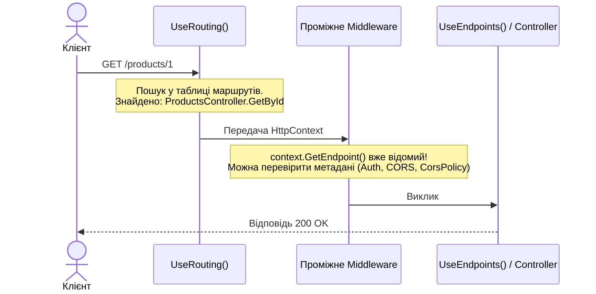

# 09. Endpoint Routing (09.Routing.Endpoints)

## Призначення та огляд

Маршрутизація в сучасному ASP.NET Core реалізована як **Endpoint Routing**. Вона розділена на два незалежні етапи, кожен з яких є окремим middleware:
1. **`UseRouting()`** — **Співставлення (Matching)**: аналізує URL, знаходить відповідний обробник (endpoint) і зберігає його в `HttpContext.GetEndpoint()`.
2. **`UseEndpoints()` / `MapControllers()`** — **Виконання (Execution)**: викликає знайдений обробник.

Розділення дозволяє вставляти інші middleware (автентифікацію, CORS, логування) **між** співставленням і виконанням, коли застосунок уже знає, який саме обробник буде викликано, але ще не почав його виконання.

---

## Двоетапна схема конвеєра



---

## Шаблони та обмеження маршрутів (Route Constraints)

ASP.NET Core підтримує багатий синтаксис шаблонів:

| Шаблон | Приклад виклику | Що робить |
|---|---|---|
| `"{id:int}"` | `/products/5` | Обмеження типу: викликається, лише якщо `id` можна розпарсити як ціле число `int`. Для рядка поверне 404. |
| `"featured"` | `/products/featured` | Літеральний сегмент. Має **вищий пріоритет**, ніж параметричний `{id}`! |
| `"{slug:alpha:minlength(3)}"` | `/categories/laptops` | Комбіновані обмеження: тільки літери (`alpha`) і довжина від 3 символів. |
| `"{*path}"` | `/files/docs/2026/report.pdf` | Catch-all (жадібний сегмент): захоплює весь залишок URL разом із слешами. |

---

## Генерація посилань через `LinkGenerator`

Замість конструювання рядків вручну (`"/products/" + id`), використовується сервіс `LinkGenerator`:
```csharp
var url = linkGenerator.GetPathByAction(
    action: nameof(GetById),
    controller: "Routing",
    values: new { id = 42 });
```
Це гарантує, що при зміні префіксів чи структури маршрутів у конфігурації всі посилання оновляться автоматично без ризику битих URL.

---

## Як запустити і перевірити

### Запуск проєкту
```bash
dotnet run --project src/09.Routing.Endpoints
```
Порт: `5009`.

### Тестові сценарії

1. **Параметричний числовий маршрут:**
   ```http
   GET http://localhost:5009/products/42
   ```
   cURL:
   ```bash
   curl -s -i http://localhost:5009/products/42
   ```
   У заголовках повертається:
   `X-Matched-Endpoint: Routing.Endpoints.Controllers.RoutingController.GetById (09.Routing.Endpoints)`.

2. **Літеральний маршрут (пріоритетніший за `{id}`):**
   ```http
   GET http://localhost:5009/products/featured
   ```
   cURL:
   ```bash
   curl -s http://localhost:5009/products/featured
   ```
   Викликається саме метод `GetFeatured()`, а не `GetById("featured")`.

3. **Складені обмеження `{slug:alpha:minlength(3)}`:**
   ```http
   GET http://localhost:5009/categories/laptops
   ```
   cURL:
   ```bash
   curl -s http://localhost:5009/categories/laptops
   ```
   Повертає категорію. Якщо надіслати `curl -s -i http://localhost:5009/categories/123` — отримаєте 404, бо обмеження не пройдено.

4. **Catch-all маршрут:**
   ```http
   GET http://localhost:5009/files/images/banners/sale.png
   ```
   cURL:
   ```bash
   curl -s http://localhost:5009/files/images/banners/sale.png
   ```
   Повертає `path = "images/banners/sale.png"`.

---

## Питання для самоперевірки та співбесіди

1. **Як працює Endpoint Routing і чому він замінив старий Legacy Routing?**
   *Відповідь:* У старому підході маршрутизація відбувалася всередині MVC middleware наприкінці конвеєра. Endpoint Routing розділив процес на два кроки: `UseRouting()` обирає кінцеву точку на початку конвеєра та зберігає метадані в `HttpContext`, а `UseEndpoints()` виконує її наприкінці. Це дозволило проміжним middleware (Auth, CORS, RateLimiting) читати атрибути ендпоінта до його виконання.
2. **Чи слід використовувати Route Constraints для бізнес-валідації вхідних даних?**
   *Відповідь:* Ні! Обмеження маршрутів (Route Constraints на кшталт `:int`, `:alpha`) служать лише для вибору правильного маршруту серед кількох кандидатів. Якщо обмеження не збіглося, сервер повертає `404 Not Found`. Для валідації значень запиту слід використовувати валідатори (DataAnnotations/FluentValidation) та повертати `400 Bad Request` із описом помилки.
3. **Як маршрутизатор вирішує неоднозначність між `/products/featured` та `/products/{id}`?**
   *Відповідь:* Літеральні сегменти шляху (`featured`) мають вищий пріоритет за параметризовані шаблони (`{id}`). Тому запит завжди потрапить у специфічніший літеральний метод.

---

## Підсумки
- Завдяки `Endpoint Routing` авторизація та CORS знають метадані кінцевої точки ще до того, як розпочнеться створення контролера чи прив'язка моделей.
- Використовуйте `Route Constraints` для захисту від некоректних типів та розведення однакових за структурою маршрутів.

---
[⬅️ Попередній: 08.Configuration.Options](08.Configuration.Options.md) | [🏠 Зміст](README.md) | [Наступний: 10.Mvc.Crud ➡️](10.Mvc.Crud.md)
