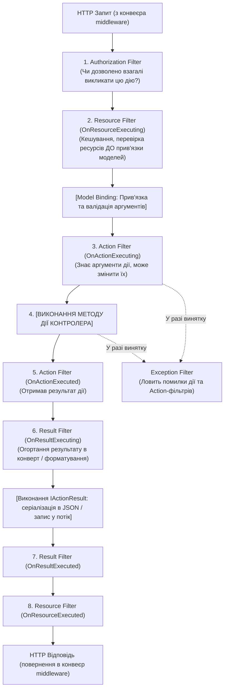

# 13. Фільтри MVC (13.Mvc.Filters)

## Призначення та огляд

Фільтри в ASP.NET Core — це «конвеєр усередині конвеєра». Якщо middleware працюють на рівні загального HTTP-запиту й нічого не знають про обраний контролер, типи його параметрів або повернене значення, то **фільтри MVC виконуються безпосередньо в контексті дій контролера**.

Цей проєкт демонструє повну послідовність виконання 5 типів фільтрів MVC:
1. **Authorization Filter**
2. **Resource Filter**
3. **Action Filter**
4. **Exception Filter**
5. **Result Filter**

---

## Порядок виконання у фільтр-пайплайні



---

## Порівняння Middleware та Filters

| Характеристика | Middleware | Filters (MVC) |
|---|---|---|
| **Область дії** | Весь застосунок, будь-який запит | Тільки MVC-контролери (або Razor Pages) |
| **Знання про дію** | ❌ Не знає методів, атрибутів, моделей | ✅ Має доступ до `ActionDescriptor`, `Arguments`, `ModelState` |
| **Зміна результату** | Працює з чистим потоком байтів `Response.Body` | Працює з C#-об'єктом `IActionResult` / `ObjectResult` до його серіалізації |
| **Доступ до помилок** | Глобальний `try/catch` навколо всього конвеєра | Перехоплення винятків конкретної дії через `IExceptionFilter` |

---

## Розбір коду: демонстраційні фільтри

У проєкті реалізовано спільний список кроків `Steps.Of(http)`, який записує точну послідовність виконання:

```csharp
// Resource Filter — до model binding
public sealed class DemoResourceFilter : IResourceFilter
{
    public void OnResourceExecuting(ResourceExecutingContext c) => Steps.Of(c.HttpContext).Add("resource: executing");
    public void OnResourceExecuted(ResourceExecutedContext c) => Steps.Of(c.HttpContext).Add("resource: executed");
}

// Action Filter — навколо методу дії
public sealed class DemoActionFilter : IActionFilter
{
    public void OnActionExecuting(ActionExecutingContext c) => Steps.Of(c.HttpContext).Add("action: executing");
    public void OnActionExecuted(ActionExecutedContext c) => Steps.Of(c.HttpContext).Add("action: executed");
}

// Result Filter — змінює IActionResult, додаючи "конверт"
public sealed class DemoResultFilter : IResultFilter
{
    public void OnResultExecuting(ResultExecutingContext c)
    {
        Steps.Of(c.HttpContext).Add("result: executing");
        if (c.Result is ObjectResult obj)
            obj.Value = new { data = obj.Value, steps = Steps.Of(c.HttpContext) };
    }
    public void OnResultExecuted(ResultExecutedContext c) { }
}

// Exception Filter — перехоплює виняток і формує 500
public sealed class DemoExceptionFilter : IExceptionFilter
{
    public void OnException(ExceptionContext c)
    {
        var steps = Steps.Of(c.HttpContext);
        steps.Add("exception filter");
        c.Result = new ObjectResult(new { error = c.Exception.Message, steps })
        {
            StatusCode = StatusCodes.Status500InternalServerError,
        };
        c.ExceptionHandled = true; // Повідомляємо, що виняток опрацьовано
    }
}
```

---

## Як запустити і перевірити

### Запуск проєкту
```bash
dotnet run --project src/13.Mvc.Filters
```
Порт: `5013`.

### Тестові сценарії

1. **Нормальне виконання запиту (ланцюжок успіху):**
   ```http
   GET http://localhost:5013/api/demo/ok
   ```
   Відповідь демонструє точний порядок виклику:
   ```json
   {
     "data": "Привіт від методу дії!",
     "steps": [
       "resource: executing",
       "action: executing",
       "action: executed",
       "result: executing"
     ]
   }
   ```

2. **Запит, що кидає виняток (перехоплення ExceptionFilter):**
   ```http
   GET http://localhost:5013/api/demo/boom
   ```
   Відповідь: `500 Internal Server Error`, сформована `DemoExceptionFilter`:
   ```json
   {
     "error": "Щось зламалося всередині дії!",
     "steps": [
       "resource: executing",
       "action: executing",
       "exception filter"
     ]
   }
   ```
   Зверніть увагу: `action: executed` та `result: executing` не викликалися, оскільки виняток перервав звичайний хід виконання і передав його в `ExceptionFilter`.

   Швидкий виклик обох сценаріїв через cURL:
   ```bash
   curl -s http://localhost:5013/api/demo/ok
   curl -s -i http://localhost:5013/api/demo/boom
   ```

---

## Питання для самоперевірки та співбесіди

1. **У якому порядку виконуються 5 типів фільтрів у MVC?**
   *Відповідь:*
   1. `Authorization Filters` (перевірка автентифікації/прав).
   2. `Resource Filters` (навколо Model Binding, наприклад для кешування результату).
   3. `Action Filters` (навколо виконання самого методу дії).
   4. `Exception Filters` (ловлять винятки з Model Binding, Action та Action Filters).
   5. `Result Filters` (навколо серіалізації/рендерингу результату).
2. **Коли слід обирати `IAsyncActionFilter` замість синхронного `IActionFilter`?**
   *Відповідь:* `IAsyncActionFilter` має зручний метод `InvokeAsync(context, next)`, де ви можете легко виконати `await next()` у стилі Middleware і при цьому писати чистий неблокуючий асинхронний код без виділення зайвих потоків пулу.
3. **Чому для глобальної обробки винятків рекомендується `UseExceptionHandler()` middleware, а не `IExceptionFilter`?**
   *Відповідь:* `IExceptionFilter` бачить лише помилки всередині MVC-конвеєра. Якщо виняток станеться у сторонньому middleware (наприклад, у CORS, аутентифікації чи статичних файлах), фільтр його не перехопить. Middleware `UseExceptionHandler()` охоплює весь веб-сервер.

---

## Підсумки
- Використовуйте **Middleware** для низькорівневих задач (CORS, логування HTTP, безпека заголовків, таймінги).
- Використовуйте **Filters** для задач, що потребують знання контракту дії, зміни структури моделі відповіді чи аудиту бізнес-параметрів.

---
[⬅️ Попередній: 12.Mvc.Controllers](12.Mvc.Controllers.md) | [🏠 Зміст](README.md) | [Наступний: 14.Rest.ResourcesAndVerbs ➡️](14.Rest.ResourcesAndVerbs.md)
