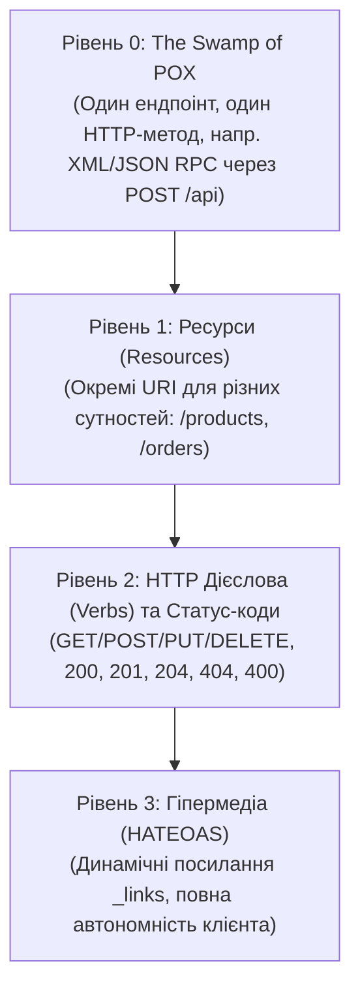

# 18. REST: Гіпермедіа та HATEOAS (18.Rest.Hypermedia)

## Призначення та огляд

Цей проєкт демонструє вершину моделі зрілості REST (Richardson Maturity Model — Рівень 3): **HATEOAS** (*Hypermedia As The Engine Of Application State*).

Головна філософія HATEOAS:
> Клієнт не повинен «зашивати» в себе жорсткі URL-адреси переходів та правил переходів між станами. Сервер сам повертає динамічний набір навігаційних гіперпосилань (`_links`) у відповіді, який залежить від **поточного бізнес-стану ресурсу**.

---

## Рівні моделі зрілості Річардсона



---

## Бізнес-сценарій: Життєвий цикл кошика покупця (`Cart`)

У нашому прикладі кошик проходить стани:
1. `Empty` (Порожній)
2. `Active` (Є товари)
3. `Submitted` (Оформлений)

Посилання `_links` адаптуються під поточний стан:

```csharp
public static object ToResource(Cart cart)
{
    var links = new Dictionary<string, object>
    {
        ["self"] = new { href = "/cart", method = "GET" }
    };

    if (cart.Status == CartStatus.Empty)
    {
        links["add-item"] = new { href = "/cart/items", method = "POST" };
    }
    else if (cart.Status == CartStatus.Active)
    {
        links["add-item"] = new { href = "/cart/items", method = "POST" };
        links["checkout"] = new { href = "/cart/checkout", method = "POST" }; // Можна оформити!
        links["clear"] = new { href = "/cart", method = "DELETE" };
    }
    else if (cart.Status == CartStatus.Submitted)
    {
        // Оформлений кошик не можна редагувати! Тільки оплатити:
        links["pay"] = new { href = "/cart/pay", method = "POST" };
    }

    return new
    {
        cart.Status,
        cart.Items,
        cart.Total,
        _links = links
    };
}
```

Клієнту більше не потрібно знати бізнес-правила (наприклад «чи можна додати товар до замовленого кошика?»). Якщо в об'єкті `_links` є посилання `checkout` — кнопка «Оформити» у фронтенді активна. Якщо посилання немає — дія заборонена.

---

## Як запустити і перевірити

### Запуск проєкту
```bash
dotnet run --project src/18.Rest.Hypermedia
```
Порт: `5018`.

### Тестові сценарії

1. **Кореневий ресурс API (Discovery):**
   ```http
   GET http://localhost:5018/
   ```
   Сервер віддає точки входу в систему:
   ```json
   {
     "_links": {
       "self": { "href": "/" },
       "products": { "href": "/products" },
       "cart": { "href": "/cart" }
     }
   }
   ```

2. **Стан 1: Порожній кошик:**
   ```http
   GET http://localhost:5018/cart
   ```
   У `_links` є тільки `self` та `add-item`. Посилання `checkout` відсутнє!

3. **Додавання товару:**
   ```http
   POST http://localhost:5018/cart/items
   Content-Type: application/json

   { "productId": 1, "quantity": 1 }
   ```
   Кошик переходить у стан `Active`. У `_links` з'являються `checkout` та `clear`.

4. **Оформлення кошика:**
   ```http
   POST http://localhost:5018/cart/checkout
   ```
   Стан стає `Submitted`. Посилання `add-item` зникає, з'являється `pay`.

---

## Підсумки
- HATEOAS робить клієнт і сервер слабозв'язаними (loosely coupled).
- Сервер може безпечно змінювати URL-адреси ендпоінтів та правила переходів між станами без потреби перекомпіляції клієнтів.
