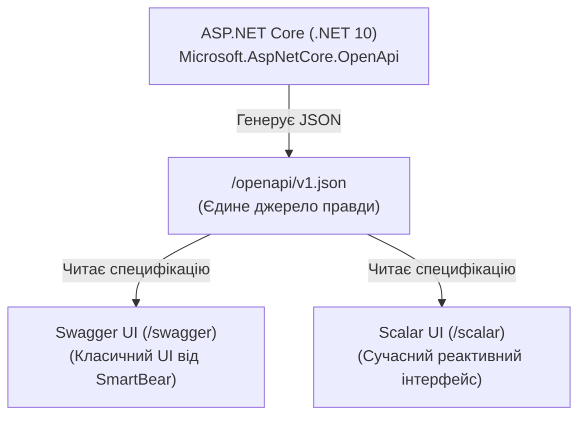

# 19. OpenAPI, Swagger UI та Scalar (19.OpenApi.Swagger)

## Призначення та огляд

OpenAPI (раніше відомий як Swagger Specification) — це машинно-читаний стандарт опису контрактів HTTP API у форматі JSON або YAML.

Починаючи з .NET 9 та закріплено в .NET 10, генерація документа OpenAPI стала **вбудованою частиною платформи** (`Microsoft.AspNetCore.OpenApi`). Сторонні бібліотеки (Swashbuckle або NSwag) більше не потрібні для генерації самого файлу специфікації.

У цьому проєкті демонструється:
1. Вбудована генерація OpenAPI-документа за адресою `/openapi/v1.json`;
2. Паралельне підключення двох UI-переглядачів:
   - Класичний **Swagger UI** (`/swagger`);
   - Сучасний **Scalar** (`/scalar`);
3. Налаштування метаданих через **Document Transformer** та **Schema Transformer**;
4. Підключення XML-документації C# для автоматичного опису параметрів та ендпоінтів.

---

## Архітектура: Одне джерело правди та два UI



UI-сторінки — це просто клієнтські статичні HTML/JS файли, які асинхронно завантажують один і той самий `/openapi/v1.json`. Вони не заважають один одному й можуть працювати одночасно.

---

## Розбір коду: Трансформери в .NET 10

Трансформери дозволяють програмно модифікувати дерево документації OpenAPI на етапі збірки або запиту.

### 1. Document Transformer: Метадані всього API
```csharp
builder.Services.AddOpenApi(options =>
{
    options.AddDocumentTransformer((document, _, _) =>
    {
        document.Info.Title = "Catalog API";
        document.Info.Description = "Навчальний приклад OpenAPI з курсу AspNet-Basics.";
        return Task.CompletedTask;
    });

    // 2. Schema Transformer: Кастомний приклад тіла для моделі ProductInput
    options.AddSchemaTransformer((schema, context, _) =>
    {
        if (context.JsonTypeInfo.Type == typeof(ProductInput))
        {
            schema.Example = new JsonObject
            {
                ["name"] = "Бездротова миша",
                ["price"] = 24.99,
                ["categoryId"] = 2
            };
        }
        return Task.CompletedTask;
    });
});
```

### 2. Підключення XML-документації
У файлі `.csproj` вмикається генерація коментарів:
```xml
<PropertyGroup>
  <GenerateDocumentationFile>true</GenerateDocumentationFile>
  <NoWarn>$(NoWarn);CS1591</NoWarn>
</PropertyGroup>
```
Тепер потрійні коментарі в C# автоматично потрапляють в опис методів:
```csharp
/// <summary>
/// Отримати товар за ідентифікатором.
/// </summary>
/// <param name="id">Унікальний числовий ID товару</param>
/// <response code="200">Товар знайдено</response>
/// <response code="404">Товар з таким ID відсутній</response>
[HttpGet("{id:int}")]
[ProducesResponseType(typeof(Product), StatusCodes.Status200OK)]
[ProducesResponseType(StatusCodes.Status404NotFound)]
public ActionResult<Product> GetById(int id) => ...
```

---

## Як запустити і перевірити

### Запуск проєкту
```bash
dotnet run --project src/19.OpenApi.Swagger
```
Порт: `5019`.

### Тестові сценарії

1. **Сирий OpenAPI JSON документ:**
   ```http
   GET http://localhost:5019/openapi/v1.json
   ```
   cURL:
   ```bash
   curl -s http://localhost:5019/openapi/v1.json
   ```
   Повертає повний опис OpenAPI 3.0/3.1.

2. **Swagger UI:**
   Відкрийте у браузері: `http://localhost:5019/swagger`.

3. **Scalar UI:**
   Відкрийте у браузері: `http://localhost:5019/scalar`.
   Зверніть увагу на сучасний дизайн, темну тему та автоматично згенеровані приклади коду на десятках мов програмування (cURL, C#, Python, JS).

---

## Питання для самоперевірки та співбесіди

1. **Чому Microsoft у .NET 9 та .NET 10 перейшла від бібліотеки Swashbuckle до вбудованого `Microsoft.AspNetCore.OpenApi`?**
   *Відповідь:* Пакет Swashbuckle тривалий час не розвивався активно його авторами, створюючи затримки з підтримкою нових версій .NET та специфікації OpenAPI 3.1. Вбудована підсистема розробляється самою командою ASP.NET Core, підтримує Native AOT, компіляторні оптимізації та працює безпосередньо з типізацією конвеєра маршрутизації.
2. **Які ключові переваги Scalar порівняно зі Swagger UI?**
   *Відповідь:* Scalar побудований на сучасних веб-технологіях, підтримує вбудований темний режим, миттєвий пошук, красиві інтерактивні схеми типів і автоматично генерує готові для копіювання фрагменти коду клієнтів (SDK snippets) на багатьох мовах (C#, TypeScript, Python, Go, cURL тощо).
3. **Як задокументувати коди відповідей для MVC та Minimal API?**
   *Відповідь:* У MVC використовують атрибути `[ProducesResponseType(typeof(T), 200)]` або узагальнений `[ProducesResponseType<T>(200)]`. У Minimal API повертають типізовані `TypedResults` (наприклад `Results<Ok<T>, NotFound>`), які документуються автоматично без жодного атрибута.

---

## Підсумки
- .NET 10 має першокласну вбудовану підтримку специфікації OpenAPI без залежності від важких сторонніх генераторів.
- Scalar надає передовий досвід для розробників під час тестування API.

---
[⬅️ Попередній: 18.Rest.Hypermedia](18.Rest.Hypermedia.md) | [🏠 Зміст](README.md) | [Наступний: 20.Testing ➡️](20.Testing.md)
