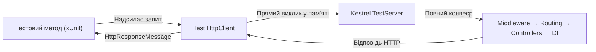

# 20. Інтеграційне тестування Web API (20.Testing)

## Призначення та огляд

Unit-тести перевіряють окремі методи в ізоляції з моками, але не дають відповіді на головні питання веб-застосунку:
- Чи правильно налаштовано конвеєр middleware?
- Чи працює автентифікація, авторизація та CORS?
- Чи коректно десеріалізується JSON та чи спрацьовує валідація?
- Чи повертаються правильні HTTP-заголовки та статус-коди?

Для повної впевненості у працездатності системи використовують **інтеграційне тестування** на базі бібліотеки `Microsoft.AspNetCore.Mvc.Testing` та інструменту **`WebApplicationFactory<TEntryPoint>`**.

---

## Як працює `WebApplicationFactory`

`WebApplicationFactory` піднімає **повний реальний застосунок у пам'яті (in-memory TestServer)** без відкриття фізичних мережевих портів:



### Переваги над тестуванням через мережу:
1. **Швидкість:** Відсутні накладні витрати на відкриття TCP-сокета й мережевий стек. Тести виконуються за частки секунди.
2. **Паралельність:** Немає конфліктів портів при паралельному запуску сотень тестів у CI/CD.
3. **Гнучкість:** Можна перевизначати сервіси в DI (наприклад, підмінити зовнішній платіжний шлюз на тестову заглушку через `WithWebHostBuilder`).

---

## Розбір коду тестів (`CatalogApiTests.cs`)

### 1. Фікстура тестового класу
```csharp
public sealed class CatalogApiTests(WebApplicationFactory<Program> factory)
    : IClassFixture<WebApplicationFactory<Program>>
{
    private readonly HttpClient _client = factory.CreateClient();
```
`IClassFixture` створює один екземпляр тестового сервера на весь клас тестів, заощаджуючи ресурси процесора.

### 2. Тест отримання колекції
```csharp
[Fact]
public async Task Get_collection_returns_200()
{
    var response = await _client.GetAsync("/products");

    Assert.Equal(HttpStatusCode.OK, response.StatusCode);
    var products = await response.Content.ReadFromJsonAsync<List<Product>>();
    Assert.NotEmpty(products!);
}
```

### 3. Тест створення та перевірка заголовка Location
```csharp
[Fact]
public async Task Post_creates_resource_and_returns_201_with_location()
{
    var input = new ProductInput { Name = "Тестовий товар", Price = 9.99m, CategoryId = 3 };

    var response = await _client.PostAsJsonAsync("/products", input);

    Assert.Equal(HttpStatusCode.Created, response.StatusCode);
    Assert.NotNull(response.Headers.Location);

    // Перевіряємо, що за повернутим Location справді можна отримати створений ресурс:
    var created = await _client.GetFromJsonAsync<Product>(response.Headers.Location);
    Assert.Equal("Тестовий товар", created!.Name);
}
```

### 4. Тест автоматичної валідації 400
```csharp
[Fact]
public async Task Post_with_invalid_body_returns_400()
{
    var bad = new ProductInput { Name = "x", Price = 0, CategoryId = 1 };

    var response = await _client.PostAsJsonAsync("/products", bad);

    Assert.Equal(HttpStatusCode.BadRequest, response.StatusCode);
}
```

### 5. Тест ідемпотентності видалення (204 кожного разу)
```csharp
[Fact]
public async Task Delete_is_idempotent_returns_204_every_time()
{
    var created = await _client.PostAsJsonAsync("/products",
        new ProductInput { Name = "На видалення", Price = 1m, CategoryId = 3 });
    var location = created.Headers.Location!;

    var first = await _client.DeleteAsync(location);
    var second = await _client.DeleteAsync(location);

    Assert.Equal(HttpStatusCode.NoContent, first.StatusCode);
    Assert.Equal(HttpStatusCode.NoContent, second.StatusCode);
}
```

---

## Важлива вимога в .NET 10: `public partial class Program;`

Оскільки у верхньорівневих операторах C# (`Top-level statements`) клас `Program` генерується як `internal`, для доступу з тестового проєкту в кінець `Program.cs` тестованого проєкту обов'язково додається:
```csharp
public partial class Program;
```
Або у файлі `.csproj` налаштовується `[InternalsVisibleTo]`.

---

## Як запустити і перевірити

### Запуск усіх тестів розв'язку через .NET CLI
```bash
dotnet test
```

### Вивід результату:
```
Passed!  - Failed: 0, Passed: 5, Skipped: 0, Total: 5, Duration: 400 ms
```

Запуск тестів з детальним виводом:
```bash
dotnet test --logger "console;verbosity=detailed"
```

---

## Питання для самоперевірки та співбесіди

1. **Як `WebApplicationFactory<TEntryPoint>` запускає тестовий сервер без відкриття реального TCP-порту?**
   *Відповідь:* Він використовує in-memory веб-хост `TestServer`. Запити від `HttpClient`, створеного через `factory.CreateClient()`, передаються безпосередньо в конвеєр ASP.NET Core через пам'ять без участі мережевого стека операційної системи, що забезпечує колосальну швидкість виконання тестів.
2. **Як підмінити справжню базу даних або зовнішній сервіс моком у тестах `WebApplicationFactory`?**
   *Відповідь:* Перевизначити метод `WithWebHostBuilder(builder => builder.ConfigureTestServices(services => { ... }))`. Там можна видалити оригінальну реєстрацію залежності (наприклад `services.RemoveAll<DbContext>()`) і зареєструвати тестовий дублер (Fake/Mock або In-Memory SQLite).
3. **Чому в кінці файлу `Program.cs` веб-проєкту необхідний рядок `public partial class Program { }`?**
   *Відповідь:* При використанні C# Top-level statements компілятор за замовчуванням генерує клас `Program` із модифікатором доступу `internal`. Щоб узагальнений параметр `WebApplicationFactory<Program>` скомпілювався в іншому проєкті `tests/20.Testing`, клас має бути доступний ззовні (або через `public partial class`, або через `[InternalsVisibleTo]`).

---

## Підсумки
- Інтеграційні тести з `WebApplicationFactory` — це найнадійніша страховка від регресій при зміні версій NuGet-пакетів, порядку middleware чи контрактів моделей.
- Вони тестують застосунок саме так, як його бачить реальний клієнт через HTTP.

---
[⬅️ Попередній: 19.OpenApi.Swagger](19.OpenApi.Swagger.md) | [🏠 Зміст](README.md) | [Наступний: 21.Security.AuthBasics ➡️](21.Security.AuthBasics.md)
