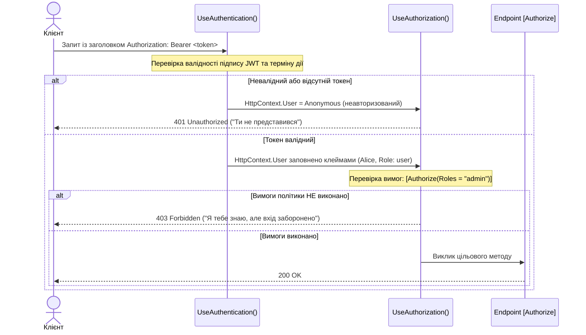

# 21. Основи безпеки: Автентифікація та Авторизація (21.Security.AuthBasics)

## Призначення та огляд

Безпека веб-застосунків складається з двох послідовних понять, які часто плутають початківці:
1. **Автентифікація (AuthN — Authentication)**: «Хто ви такий?» — перевірка особи користувача та побудова об'єкта `ClaimsPrincipal` (`HttpContext.User`).
2. **Авторизація (AuthZ — Authorization)**: «Чи маєте ви право виконати цю дію?» — перевірка ролей, прав чи політик доступу.

Обидва процеси реалізовані як окремі middleware в конвеєрі ASP.NET Core. У цьому проєкті демонструється аутентифікація за допомогою **JWT Bearer (JSON Web Token)** та авторизація на основі **ролей і політик**.

---

## Порядок у конвеєрі та різниця статусів



> [!IMPORTANT]
> **401 Unauthorized:** Клієнт не автентифікований (відсутній або пошкоджений токен).
> **403 Forbidden:** Клієнт успішно автентифікований, але його прав/ролей недостатньо для цього ресурсу.

---

## Розбір коду

### 1. Налаштування схеми JWT у `Program.cs`
```csharp
var signingKey = new SymmetricSecurityKey(
    Encoding.UTF8.GetBytes("ДЕМО-КЛЮЧ-НЕ-ДЛЯ-ПРОДУ-мінімум-32-байти!!"));

builder.Services.AddSingleton(signingKey);

// AuthN: схема Bearer
builder.Services
    .AddAuthentication(JwtBearerDefaults.AuthenticationScheme)
    .AddJwtBearer(options => options.TokenValidationParameters = new()
    {
        ValidateIssuerSigningKey = true,
        IssuerSigningKey = signingKey,
        ValidateLifetime = true,
        ValidateIssuer = false,
        ValidateAudience = false,
    });

// AuthZ: іменована політика
builder.Services.AddAuthorizationBuilder()
    .AddPolicy("admin", p => p.RequireRole("admin"));
```

### 2. Обов'язковий порядок у конвеєрі
```csharp
app.UseAuthentication(); // 1. Розбирає заголовок, перевіряє JWT, формує HttpContext.User
app.UseAuthorization();  // 2. Перевіряє [Authorize] на основі HttpContext.User
```
Якщо поміняти їх місцями — `UseAuthorization` бачитиме тільки анонімного користувача і завжди відхилятиме запити!

### 3. Захист контролерів
```csharp
[ApiController]
public sealed class AuthControllers : ControllerBase
{
    // Будь-який залогінений користувач
    [Authorize]
    [HttpGet("/me")]
    public object Me() => new
    {
        username = User.Identity?.Name,
        roles = User.Claims.Where(c => c.Type == ClaimTypes.Role).Select(c => c.Value)
    };

    // Тільки користувачі з політикою "admin"
    [Authorize(Policy = "admin")]
    [HttpGet("/admin")]
    public object AdminOnly() => new { secret = "Тільки для адміністраторів!" };
}
```

---

## Як запустити і перевірити

### Запуск проєкту
```bash
dotnet run --project src/21.Security.AuthBasics
```
Порт: `5021`.

### Тестові сценарії

1. **Запит без токена на захищений ендпоінт:**
   ```http
   GET http://localhost:5021/me
   ```
   cURL:
   ```bash
   curl -s -i http://localhost:5021/me
   ```
   Відповідь: `401 Unauthorized`.

2. **Отримання токена для звичайного користувача (bob / password):**
   ```http
   POST http://localhost:5021/token
   Content-Type: application/json

   { "username": "bob", "password": "password" }
   ```
   cURL:
   ```bash
   curl -s -X POST http://localhost:5021/token -H "Content-Type: application/json" -d "{\"username\":\"bob\",\"password\":\"password\"}"
   ```
   Сервер повертає JWT токен.

3. **Успішний доступ до `/me` з токеном:**
   ```http
   GET http://localhost:5021/me
   Authorization: Bearer <токен_боба>
   ```
   cURL:
   ```bash
   # Отримати токен та одразу викликати /me:
   TOKEN=$(curl -s -X POST http://localhost:5021/token -H "Content-Type: application/json" -d "{\"username\":\"bob\",\"password\":\"password\"}" | grep -o '"token":"[^"]*' | cut -d'"' -f4)
   curl -s http://localhost:5021/me -H "Authorization: Bearer $TOKEN"
   ```
   Повертає `200 OK`.

4. **Спроба доступу Боба до `/admin` (403 Forbidden):**
   ```http
   GET http://localhost:5021/admin
   Authorization: Bearer <токен_боба>
   ```
   cURL:
   ```bash
   curl -s -i http://localhost:5021/admin -H "Authorization: Bearer $TOKEN"
   ```
   Повертає `403 Forbidden`! Токен валідний, але Боб не є адміністратором.

5. **Отримання токена адміністратора (alice / password) та виклик `/admin`:**
   ```bash
   ADMIN_TOKEN=$(curl -s -X POST http://localhost:5021/token -H "Content-Type: application/json" -d "{\"username\":\"alice\",\"password\":\"password\"}" | grep -o '"token":"[^"]*' | cut -d'"' -f4)
   curl -s http://localhost:5021/admin -H "Authorization: Bearer $ADMIN_TOKEN"
   ```
   Повертає `200 OK` (`Тільки для адміністраторів!`).

---

## Питання для самоперевірки та співбесіди

1. **У чому фундаментальна відмінність між Аутентифікацією (Authentication, 401) та Авторизацією (Authorization, 403)?**
   *Відповідь:*
   - **Аутентифікація (401 Unauthorized):** перевірка «Хто ви такий?». Якщо облікові дані відсутні або токен невалідний/прострочений — сервер повертає 401.
   - **Авторизація (403 Forbidden):** перевірка «Чи маєте ви право виконати цю дію?». Користувач успішно розпізнаний, але його ролі або політики недостатні для доступу.
2. **Чому `UseAuthentication()` обов'язково має стояти перед `UseAuthorization()`?**
   *Відповідь:* `UseAuthentication()` розбирає заголовок `Authorization`, перевіряє криптографічний підпис токена і заповнює об'єкт `HttpContext.User (ClaimsPrincipal)`. Якщо поміняти порядок, `UseAuthorization()` запускатиметься раніше і завжди бачитиме незалогіненого анонімного користувача.
3. **Чому Policy-based авторизація вважається кращою за пряму Role-based авторизацію (`[Authorize(Roles = "Admin")]`)?**
   *Відповідь:* Політики відокремлюють бізнес-правила від контролерів. Замість хардкоду імен ролей ви оголошуєте абстрактну політику (наприклад `"RequireManagerAccess"`), а правила її задоволення (наявність ролі, вік, філіал компанії, підтверджений email) налаштовуєте в конфігурації DI без редагування атрибутів у коді.

---

## Застереження щодо безпеки
> [!CAUTION]
> У навчальному прикладі секретний ключ і користувачі зашиті в коді. У реальному продакшені:
> - Ключі шифрування зберігаються в Azure Key Vault, AWS Secrets Manager або системних секретах.
> - Аутентифікація делегується спеціалізованим Identity Provider (Keycloak, Auth0, Entra ID / Azure AD).
> - Використання HTTPS є суворо обов'язковим для захисту токена від перехоплення в транзиті.

---
[⬅️ Попередній: 20.Testing](20.Testing.md) | [🏠 Зміст](README.md) | [Наступний: 22.Diagnostics.HealthChecks ➡️](22.Diagnostics.HealthChecks.md)
